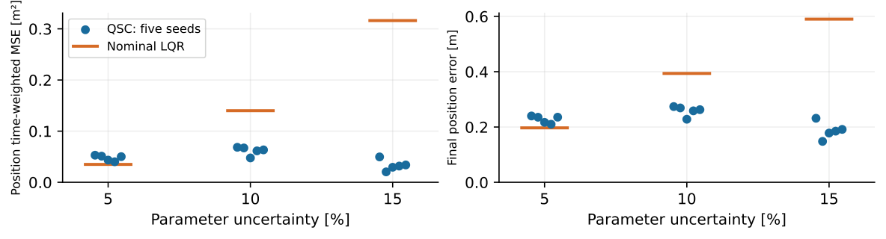

# Quadratic Stability Control

MATLAB implementation for **Robust Sampling-Based Control for Elastic Lattices with Parameter Uncertainty**, by Ali Jnadi, Sergei Savin and Yaroslav Kholodov.

The method computes a constant state-feedback gain for a nonlinear mass-spring-damper lattice with uncertain physical parameters. A common quadratic Lyapunov condition is imposed on local linear models sampled jointly in state and parameter space. The main baseline is a nominal unit-weight LQR.


## Requirements

- MATLAB R2019b, with Symbolic Math Toolbox and Control System Toolbox.
- CVX 2.2 with SeDuMi and SDPT3. Install CVX separately and run `cvx_setup` before using the scripts.

The recorded experiments used MATLAB R2019b. Other MATLAB or solver versions may return different feasible gains and numerical results.

## Running the experiments

Open MATLAB in the repository root. For a small example:

```matlab
run_all_experiments('quick')
```

This runs a reduced controller comparison and a Jacobian/actuator-mapping check. It replaces the standard `results/quick/` folder and is not the full paper protocol.

For the principal sweeps and five-design uncertainty study:

```matlab
options = struct;
options.stages = {'mapping', 'sweeps', 'diagnostic'};
options.output_dir = fullfile(pwd, 'results', 'paper');
run_all_experiments('full', options)
```

For Appendix A, use `{'mapping', 'comparison', 'sampling'}` in a separate output directory. For the scaling study, use `{'mapping', 'scaling'}`. To run every implemented experiment, including additional controller comparisons and force-bound studies:

```matlab
run_all_experiments('full')
```

Settings are in `qsc_settings.m`. Full runs retain checkpoints and resume only when source, settings and software metadata match. Use a new output directory after changing them. Do not run two processes into the same output directory. Full experiments can take considerable time.

## Saved results

This lightweight package includes the experiment code, summary tables and figures. Per-trial CSVs, saved MATLAB controller designs, sampled matrices and validation inputs are omitted to reduce download size. They remain in the full archive. New runs write fresh records to `results/`.

The [paper-to-file guide](docs/PAPER_RESULTS.md) identifies the source of each result. [Experimental protocols](docs/PROTOCOLS.md) lists seeds, solvers, sampling laws, integration settings and metric definitions.

To regenerate the full records and plots, run the experiments above. Regenerating outputs from archived trials requires the full archive.



In the five-design study, QSC has higher position error than nominal LQR at 5% uncertainty. At 10% and 15%, it has lower position error but uses more force. The reported spreads are standard deviations across five design-level case means, not confidence intervals.

## Implementation notes

- Feedback is applied as `u = u_ref + K*e`. MATLAB's native LQR gain is negated once when constructing the simulation design.
- Full force ordering is `[all x; all y]`; reduced ordering is `[x on active masses; y on active masses]`.
- In the QSC solver, the second output is the change-of-variables matrix `X`, despite its legacy name `P`. The Lyapunov storage matrix is `inv(X)`.
- The bound on `Y = K*X` is not an actuator force limit. Principal manuscript simulations are unsaturated.
- The common certificate covers the sampled homogeneous matrices and their convex hull. It does not establish stability over the full nonlinear domain or exact regulation after an uncertain equilibrium shift.

## Citation

Ali Jnadi, Sergei Savin and Yaroslav Kholodov, *Robust Sampling-Based Control for Elastic Lattices with Parameter Uncertainty*, manuscript submitted to Actuators.

Repository citation metadata is provided in [CITATION.cff](CITATION.cff). No software license is specified; contact the authors about reuse.
