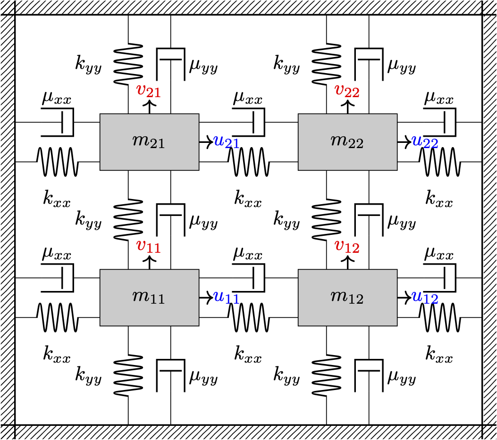
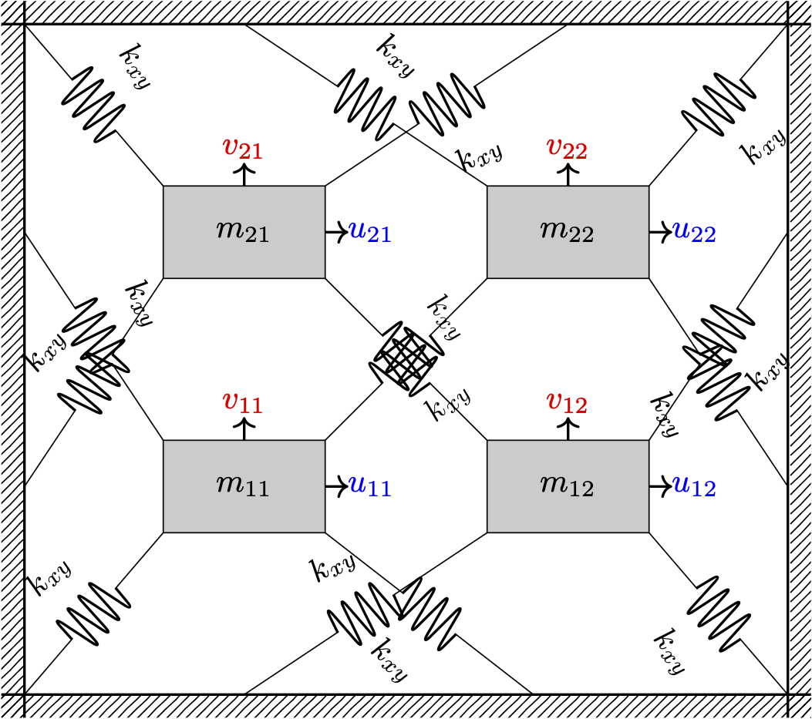

# Quadratic Stability Control (QSC)

MATLAB implementation and numerical experiments for **sampling-based Quadratic
Stability Control** of a nonlinear mass–spring–damper lattice with parametric
uncertainty, benchmarked against a nominal Linear Quadratic Regulator (LQR).

QSC synthesizes a single state-feedback gain by enforcing a common quadratic
Lyapunov condition over a finite set of local linear models, sampled across
variations in both system state and uncertain physical parameters. The
synthesis problem is a linear matrix inequality (LMI), solved as a
semidefinite program via [CVX](http://cvxr.com/cvx/).

This repository accompanies the paper *"Robust Sampling-Based Control for
Elastic Lattices with Parameter Uncertainty"* (citation details below).

<div align="center">
<table>
<tr>
<td></td>
<td></td>
</tr>
</table>
</div>

## Table of Contents

- [Requirements](#requirements)
- [Getting Started](#getting-started)
- [Repository Structure](#repository-structure)
- [Reproducing the Paper's Results](#reproducing-the-papers-results)
- [Additional Experiments](#additional-experiments)
- [System Configuration](#system-configuration)
- [Known Limitations](#known-limitations)
- [Reported Timings and Hardware](#reported-timings-and-hardware)
- [Citation](#citation)
- [License](#license)

## Requirements

- [MATLAB](https://www.mathworks.com/products/matlab.html) — developed and
  tested on R2019b (9.7.0.1190202); newer releases are expected to work but
  have not been verified.
- [CVX](http://cvxr.com/cvx/), version 2.2 (Build 1148), with
  [SeDuMi](https://sedumi.ie.lehigh.edu/) as the underlying solver (the
  version of CVX linked above bundles SeDuMi).
- MATLAB's Symbolic Math Toolbox (used by `f_grid_symbolic.m` to derive the
  nonlinear equations of motion and their Jacobians).

To install CVX:
1. Download CVX from [here](http://cvxr.com/cvx/download/).
2. Extract the contents and add the folder to your MATLAB path.
3. Run `cvx_setup` in MATLAB to complete the installation.

## Getting Started

```bash
git clone https://github.com/AliJnadi/Quadratic-Stability-Control.git
cd Quadratic-Stability-Control/"Matlab Codes"
```

Open MATLAB, `cd` into `Matlab Codes/`, and run any of the top-level scripts
described below. All scripts read their parameters from `config.m`.

## Repository Structure

```
Quadratic-Stability-Control/
├── img/                              # Figures used in this README
├── HOW_TO_RERUN_AND_SEND_RESULTS.md  # Step-by-step rerun log (development notes)
└── Matlab Codes/
    ├── config.m                      # All system/experiment parameters
    ├── f_grid_symbolic.m             # Symbolic derivation of the nonlinear lattice dynamics
    ├── validate_symbolic_model.m     # Sanity-checks the symbolic model at equilibrium
    ├── generate_operating_point.m    # Computes a dynamically feasible reference (x_ref, u_ref)
    ├── generate_samples.m            # Samples (state, input, parameter) points for QSC synthesis/testing
    ├── compute_system_matrices.m     # Evaluates Jacobians (A_s, B_s) at sampled points
    ├── solve_quadratic_stability.m   # Core LMI/SDP synthesis (QSC) and LQR baseline, via CVX
    ├── check_stability_samples.m     # Simulates the nonlinear closed loop and reports MSE/SSE
    ├── expand_input.m, apply_force_selector.m  # Actuator-selection helpers
    ├── Final_Table.m                 # Optional helper: formats a quick console table from
    │                                  #   workspace variables left over after a single Bulk_Test_* run
    │
    ├── Bulk_Test_Samples.m           # Sweep over number of synthesis samples N
    ├── Bulk_Test_Radius.m            # Sweep over state sampling radius r
    ├── Bulk_Test_Uncer.m             # Sweep over parameter uncertainty level U
    ├── act_test.m                    # Sweep over number/placement of actuators
    │
    ├── tests/N/, tests/R/, tests/U/  # Per-sweep .mat results, merge_results.m, make_all_plots.m
    ├── test_forces/                  # Actuator-sweep .mat results and plot_forces.m
    │
    ├── validate_lyapunov_margin.m    # Independent held-out validation of the stability certificate
    └── scaling_vs_dimension.m        # Empirical sample-count-vs-dimension scaling study
```

## Reproducing the Paper's Results

Each of the four sweeps below writes its raw `.mat` results into its own
folder, then a `merge_results.m` / `plot_forces.m` script aggregates them,
regenerates the figures, and exports a plain CSV summary (so results can be
inspected or shared without needing to reopen `.mat`/`.fig` files).

```matlab
cd 'Matlab Codes'

% 1. Number of synthesis samples N  ->  Table 3 in the paper
Bulk_Test_Samples
cd tests/N,  make_all_plots,  cd ../..

% 2. State sampling radius r  ->  Table 4
Bulk_Test_Radius
cd tests/R,  make_all_plots,  cd ../..

% 3. Parameter uncertainty level U  ->  Table 5
Bulk_Test_Uncer
cd tests/U,  make_all_plots,  cd ../..

% 4. Number/placement of actuators  ->  Table 6
act_test
cd test_forces,  plot_forces,  cd ..
```

Each `make_all_plots`/`plot_forces` call globs `*.mat` in its own folder, so
make sure the folder only contains `.mat` files from the sweep you intend to
plot (they overwrite in place by filename as long as `config.m`'s swept
values are unchanged).

Outputs of interest after running all four:
- `tests/N/summary_N_sweep.csv`, `tests/N/merged_raw_N_sweep.csv`
- `tests/R/summary_R_sweep.csv`
- `tests/U/summary_U_sweep.csv`
- `test_forces/summary_actuator_sweep.csv`, `test_forces/raw_actuator_results.csv`
- corresponding `.png`/`.eps`/`.fig` figures in each folder

## Additional Experiments

Two standalone scripts go beyond what's reported in the current paper draft:

**`validate_lyapunov_margin.m`** — synthesizes QSC at the design point in
`config.m`, then independently evaluates the Lyapunov derivative condition
on a large held-out set of state/parameter points (a different RNG seed from
both synthesis and the standard test set). Reports the fraction of held-out
points satisfying the condition and the mean/worst-case stability margin,
including a breakdown by radial distance from the reference point. Outputs:
`lyapunov_margin_vs_distance.png`, `validation_lyapunov_margin_points.csv`,
`validation_lyapunov_margin_bins.csv`, `validation_lyapunov_margin_summary.csv`.

**`scaling_vs_dimension.m`** — empirically estimates, for a small set of
increasing lattice sizes, the minimum number of synthesis samples `N*(n)`
needed to reach a prescribed held-out stability margin, and the associated
synthesis time. This is a coarse scan (SDP synthesis time dominates runtime
for larger lattices — see [Known Limitations](#known-limitations)) intended
as a starting point. Outputs: `scaling_vs_dimension_summary.png`,
`scaling_vs_dimension_summary.csv`, `scaling_vs_dimension_detail.csv`.

Both scripts are independent of the four sweeps above and of each other, and
can be run in any order once `config.m` is set up.

## System Configuration

All system and experimental parameters are set in `config.m`. The default
(nominal) values used for the results in the paper are:

| Parameter | Value |
|-----------|-------|
| System dimension (rows × cols) | 2 × 2 |
| Number of synthesis samples $N$ | 100 |
| Number of test trajectories $N_t$ | 1000 |
| State sampling radius $r$ | 0.05 |
| Parameter uncertainty level $U$ | 0.1 |
| Stiffness coefficient $k$ | 1 |
| Stiffness coefficient for diagonal springs $k_d$ | 0.5 |
| Nominal length $l$ | 1 |
| Damping coefficient $\mu_l$ | 1 |
| Damping coefficient for diagonal dampers $\mu_d$ | 0.5 |
| Masses $m_i$ | 1, $i = 1,\dots,4$ |

Edit `config.m` to explore other lattice sizes, sampling densities, or
uncertainty levels; the four `Bulk_Test_*`/`act_test` scripts sweep one
parameter at a time around these defaults.

## Known Limitations

- **Non-square lattices.** Passing a non-square grid (`row ~= col` in
  `f_grid_symbolic`/`config.m`) currently triggers an error further down the
  pipeline; the root cause has not yet been isolated. `scaling_vs_dimension.m`
  is restricted to square grids (`row == col`) as a workaround until this is
  fixed.
- **SDP cost at larger dimensions.** Synthesis time grows sharply with state
  dimension (see `scaling_vs_dimension_summary.csv`): a few seconds for a
  2×2 lattice (state dimension 16), but on the order of hundreds to
  thousands of seconds for a 4×4 lattice (state dimension 64) on the
  hardware below. Plan accordingly before sweeping larger lattices.
- **Solver-time interpretation.** Reported solver times are wall-clock,
  single-machine measurements (see below) and are meant for relative
  comparison (QSC vs. LQR, across sweeps), not as absolute or
  hardware-independent benchmarks. In particular, for the radius (`r`) and
  uncertainty (`U`) sweeps, the plotted solver time is the **mean** over the
  swept values rather than per-point values, since the number of LMI
  constraints — and hence the theoretically expected solver time — depends
  only on the number of synthesis samples `N` (fixed within each of those
  sweeps), not on `r` or `U`.
- **Typo in generated figures (fixed in source, not yet in checked-in
  images).** `tests/U/make_all_plots.m` previously spelled "Uncertainty" as
  "Uncertainity" in plot titles/axis labels and output filenames. This has
  been corrected in the script, but the `.png`/`.eps`/`.fig` files currently
  checked into `tests/U/` still have the old (misspelled, old-filename)
  versions, since regenerating them requires MATLAB. Rerun
  `tests/U/make_all_plots.m` to produce the corrected
  `trajectory_mse_vs_uncertainty.png`, `ss_error_vs_uncertainty.png`, and
  `time_vs_uncertainty.png` (note the corrected spelling) before using these
  figures in any external document.

## Reported Timings and Hardware

All solver-time results reported in the paper and in the CSV/figure outputs
of this repository were measured with:

- MATLAB R2019b (9.7.0.1190202)
- CVX 2.2 (Build 1148) with SeDuMi as the underlying solver
- Apple MacBook Air, Apple M1 chip (8 cores: 4 performance + 4 efficiency),
  8 GB unified memory, macOS

Absolute timings will differ on other hardware/software combinations;
relative comparisons (QSC vs. LQR, trends across `N`, `r`, `U`) are expected
to be more portable than the absolute values themselves.

## Citation

If you use this repository in your research, please cite the corresponding
publication (citation details to be added upon publication):

```
Ali Jnadi, Sergei Savin, Yaroslav Kholodov, "Robust Sampling-Based Control
for Elastic Lattices with Parameter Uncertainty," Actuators, 2026 (submitted).
```

## License

See the repository's license file, or contact the authors if none is present.
